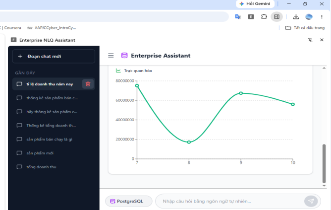

# Enterprise NLQ

Enterprise NLQ là hệ thống truy vấn dữ liệu doanh nghiệp bằng ngôn ngữ tự nhiên. Người dùng đặt câu hỏi trong giao diện Chrome Extension; backend NestJS tìm schema phù hợp bằng vector search, dùng Gemini để sinh SQL PostgreSQL, kiểm tra SQL bằng guardrails và trả kết quả kèm nhận xét AI cùng biểu đồ.


## Tính năng

- Chat bằng tiếng Việt để truy vấn dữ liệu doanh nghiệp
- Text-to-SQL với Gemini và ngữ cảnh lịch sử hội thoại
- Vector Search sử dụng embeddings để tìm các bảng/schema liên quan
- Business glossary cho các thuật ngữ và quy tắc SQL nội bộ
- Kiểm duyệt SQL: chỉ cho phép một câu lệnh `SELECT`, tự động thêm `LIMIT 100`
- Lưu lịch sử chat, kết quả, biểu đồ và audit log trong PostgreSQL
- Hiển thị dữ liệu dạng bảng, biểu đồ cột, đường hoặc tròn
- Quản lý, tải lại và xóa phiên chat
- Theo dõi thay đổi schema doanh nghiệp và đồng bộ vector metadata
- Tự động tạo báo cáo Excel theo lịch

## Cấu trúc project

```text
enterprise_nlq/
├── enterprise-nlq-backend/       # REST API NestJS
│   └── src/
│       ├── ai/                   # Gemini Text-to-SQL và phân tích dữ liệu
│       ├── database/             # PostgreSQL core và business pool
│       ├── guardrails/           # Kiểm tra và làm sạch SQL
│       ├── orchestrator/         # Điều phối RAG, SQL, dữ liệu và audit
│       ├── vector-search/        # Embedding và tìm schema
│       ├── cron-scheduler/       # Radar schema và báo cáo định kỳ
│       ├── report-generator/     # Tạo file Excel
│       ├── email-service/        # Gửi kết quả qua SMTP
│       └── chatops/
└── enterprise-nlq-extension/     # React + TypeScript Chrome Side Panel
```

## Công nghệ

- Backend: NestJS, TypeScript, PostgreSQL (`pg`)
- AI: Google Gemini API
- Vector: PostgreSQL/pgvector
- SQL validation: `node-sql-parser`
- Email: Nodemailer
- Báo cáo: ExcelJS
- Frontend: React 19, Vite, Tailwind CSS, Recharts
- Extension: Chrome Manifest V3 Side Panel

## Cấu hình PostgreSQL

Project sử dụng hai database:

| Database | Mục đích |
|---|---|
| Core DB | Lưu `audit_logs`, `business_glossary`, `schema_metadata` và vector metadata |
| Business DB | Chứa dữ liệu doanh nghiệp để đọc bằng câu lệnh `SELECT` |

Core DB cần các bảng sau hoặc schema tương đương:

- `audit_logs(log_id, natural_query, execution_time, status, chat_history)`
- `business_glossary(term_name, definition, sql_logic)`
- `schema_metadata(table_name, description, embedding vector)`

Bảng Business DB phải sử dụng các cột có kiểu dữ liệu được project quét bằng `information_schema.columns`.

> Core và Business database nên dùng tài khoản có quyền tối thiểu cần thiết. Business DB chỉ nên cấp quyền đọc.

## Cấu hình backend
```dotenv
PORT=3000

CORE_DB_HOST=
CORE_DB_PORT=5432
CORE_DB_USER=
CORE_DB_PASS=
CORE_DB_NAME=

BIZ_DB_HOST=
BIZ_DB_PORT=5432
BIZ_DB_USER=
BIZ_DB_PASS=
BIZ_DB_NAME=

GEMINI_API_KEY=

SMTP_HOST=
SMTP_PORT=587
SMTP_SECURE=false
SMTP_USER=
SMTP_PASS=
SMTP_FROM=
```

Các biến `EMAIL_HOST`, `EMAIL_PORT`, `EMAIL_USER`, `EMAIL_PASS` cũng được Email Service hỗ trợ như tên thay thế cho cấu hình SMTP.

## API chính

| Method | Endpoint | Mô tả |
|---|---|---|
| `GET` | `/test-db` | Kiểm tra kết nối Business DB |
| `GET` | `/test-ai?q=...` | Kiểm tra sinh SQL AI |
| `POST` | `/api/query` | Gửi câu hỏi NLQ |
| `GET` | `/api/query/sessions` | Lấy tối đa 50 phiên chat |
| `GET` | `/api/query/history/:sessionId` | Lấy lịch sử phiên chat |
| `DELETE` | `/api/query/history/:sessionId` | Xóa phiên chat |
| `GET` | `/vector-search/test?q=...` | Kiểm tra tìm kiếm schema |
| `GET` | `/vector-search/seed` | Đồng bộ metadata từ Business DB |

Ví dụ truy vấn:

```json
POST /api/query
{
  "sessionId": "demo-session",
  "question": "Liệt kê 5 khách hàng mới nhất",
  "history": []
}
```

## Luồng xử lý

```text
Câu hỏi người dùng
  -> Vector Search tìm schema liên quan
  -> Lấy business glossary
  -> Gemini sinh SQL và loại biểu đồ
  -> AST guardrails kiểm tra SQL
  -> PostgreSQL Business DB thực thi SELECT
  -> Gemini phân tích dữ liệu
  -> Lưu lịch sử/audit log
  -> Trả bảng dữ liệu + nhận xét + biểu đồ
```

